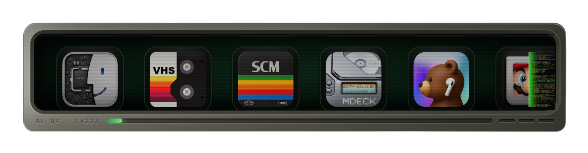

  

Hey, I’m Allen Lee. Interpretability researcher and ex-founder (consumer products), based in SF and Taipei. I study what safety training and refusal-editing actually change inside language models.

If you work on making frontier models safer, I’d love to [hear from you](mailto:allenleexyz@gmail.com). I also like talking to people building consumer products with real craft.
